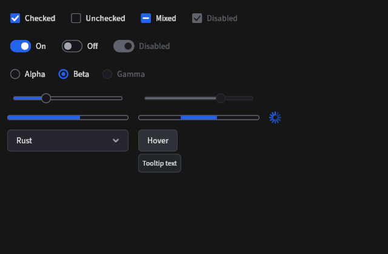
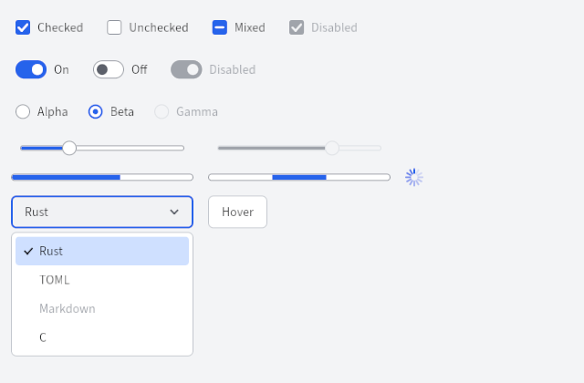
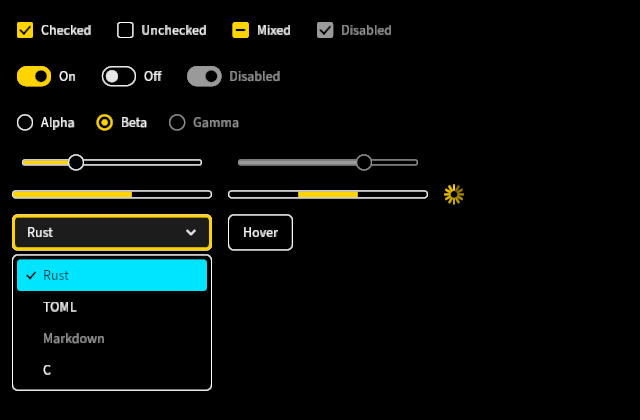

# Standard form controls

Status: check boxes, switches, radio groups, sliders, progress bars, spinners,
selects and hover tooltips are implemented with the default layout feature.
`rendering` paints their vector marks; `accessibility` publishes them through
AccessKit. Every control is composed from existing primitives, so focus, input
routing, theming and semantics follow the same contracts as buttons and popovers.

## Application API

```rust
use rxui::prelude::*;

struct Settings { wrap: bool, sync: bool, endings: Key, zoom: f32, language: Key }
impl View for Settings {
    fn view(&self, cx: &mut ViewContext<'_, Self>) -> impl IntoElement {
        column().gap(10.)
            .child(checkbox(self.wrap, "Wrap lines")
                .on_change(cx.listener(|s, e: &ToggleEvent, _| s.wrap = e.checked)))
            .child(switch(self.sync, "Background sync")
                .on_change(cx.listener(|s, e: &ToggleEvent, _| s.sync = e.checked)))
            .child(radio_group().selected(self.endings.clone())
                .accessibility_label("Line endings")
                .option(choice("lf", "LF"))
                .option(choice("crlf", "CRLF"))
                .on_change(cx.listener(|s, e: &ChoiceEvent, _| s.endings = e.key.clone())))
            .child(slider(self.zoom).range(50., 200.).step(10.)
                .accessibility_label("Zoom")
                .on_change(cx.listener(|s, e: &SliderEvent, _| s.zoom = e.value)))
            .child(select(cx).selected(self.language.clone())
                .accessibility_label("Language")
                .option(choice("rust", "Rust"))
                .option(choice("toml", "TOML"))
                .on_change(cx.listener(|s, e: &ChoiceEvent, _| s.language = e.key.clone())))
            .child(tooltip(cx, button("Format"), "Reformat the document"))
    }
}
```

Values are controlled. The application owns each value and receives a typed
proposal: `ToggleEvent { checked }` from check boxes and switches,
`ChoiceEvent { key }` from radio groups and selects, and
`SliderEvent { value, phase }` from sliders. Storing the proposal accepts it;
ignoring or replacing it rejects or normalizes it. A control without a listener
still focuses and publishes its state but cannot change.

The builders return `Toggle`, `RadioGroup`, `Slider`, `ProgressBar` and `Select`.
Each accepts `.key(...)`, `.accessibility_label(...)`,
`.accessibility_description(...)`, `.width(...)`, `.fill_width()`, `.flex_grow(...)`,
`.min_width(...)` and `.layout(...)` for its root, plus `.disabled(true)` where
input applies. Call `.into_element()` for any other element builder. `spinner(cx)`
and `tooltip(cx, ...)` return an ordinary `Element`.

Options are `choice(key, caption)`, optionally `.disabled(true)`. Keys are unique
within one group or select; duplicates fail preparation with
`UiError::DuplicateKey`. A selected key that names no option leaves a radio group
unchecked and shows a select's placeholder. Slider and progress ranges must be
finite with `min <= max`, and a slider step must be positive; invalid ranges fail
preparation with `UiError::InvalidStyle` rather than panicking.

## Check boxes and switches

`checkbox(checked, caption)` accepts a `bool` or `Checked`. `Checked::Mixed` paints
a bar, is published as mixed, and proposes `true` when activated, so a parent box
can drive its children. `switch(on, caption)` is an on/off toggle with the Switch
role. Both are quiet buttons: pointer clicks, Enter/Space and assistive Click use
the ordinary button activation path. The caption is the accessible name; a control
without a caption needs `.accessibility_label(...)`.

## Radio groups

`radio_group()` holds options in navigation order; `.axis(Axis::Horizontal)` lays
them out in a row. The group is one Tab stop: the selected enabled option, or the
first enabled option without a selection. Arrow keys in either orientation move
focus to the next or previous enabled option, wrapping and skipping disabled
options, and propose it immediately, like the platform radio group. Space, Enter,
clicks and assistive Click propose the activated option. Arrow keys with any
modifier are left to other handlers. Each option publishes the RadioButton role,
its checked state, its zero-based position and the group size; the group is a named
Group.

Focus moves through a fresh `FocusHandle` per option, queued during the key event
and applied at the next preparation, so the new option is focused even when the
application rejects the proposal.

## Sliders

`slider(value)` defaults to a 0..=1 continuous range, 200 logical units wide.
`.range(min, max)`, `.step(step)` and `.page_step(page)` configure it. Values are
clamped to the range and snapped to the step before they are proposed.

| Input | Proposal and phase |
| --- | --- |
| Primary press | Captures the pointer, focuses the slider and jumps to the pointer: `Begin` |
| Captured motion | Follows the pointer horizontally, anywhere in the window: `Drag` |
| Release | Final pointer value: `End` |
| Escape, host cancellation or removal | Repeats the current value: `Cancel` |
| Right/Up, Left/Down | One step (a hundredth of the range without a step): `Keyboard` |
| PageUp, PageDown | One page, a tenth of the range or one step, whichever is larger: `Keyboard` |
| Home, End | Minimum, maximum: `Keyboard` |
| Assistive SetValue, Increment, Decrement | Clamped and snapped value: `Accessibility` |

Drag and key proposals equal to the current value are not sent. Cancellation does
not roll back: the slider does not retain the value from before the press, so an
application that wants Escape to restore it stores the value it held before `Begin`.
The slider publishes the Slider role with its value, range and step, and supports
AccessKit SetValue/Increment/Decrement through `on_semantic_action`.

## Progress bars and spinners

`progress_bar(value)` takes `f32` or `Option<f32>`. A value shows determinate
progress through `.range(min, max)` (0..=1 by default) and publishes a numeric
ProgressIndicator. `None` shows an indeterminate segment and publishes the value
text "Indeterminate". `.animate(cx)` sweeps that segment from the view's frame
clock; it calls `request_animation_frame` on every evaluation while the bar is
indeterminate and does nothing for a determinate bar.

`spinner(cx)` is a 20-unit activity indicator named "Loading", painted in the
accent color. It always requests the next frame. Both animations re-evaluate the
owning view once per frame while shown, so put them in a small component when the
surrounding view is expensive, and remove them when the work finishes. They use
the existing frame clock and request; they are not an animation system.

## Selects

`select(cx)` is a ComboBox button showing the current option's caption, or the
`.placeholder(...)` text in a muted color, with a chevron. Activating it opens a
ListBox popover anchored below it, flipped above when there is no room. Focus stays
on the button while the list is open, as in the platform combo box pattern; the
highlighted option is placement-local state.

| State | Keys |
| --- | --- |
| Closed | Up/Down open the list on the selection. Enter/Space open it through ordinary activation. A letter proposes the next enabled option whose caption starts with it. |
| Open | Up/Down move the highlight without wrapping, Home/PageUp and End/PageDown jump to the ends, a letter moves to the next match, Enter/Space choose the highlight and close, Tab closes and moves focus, Escape closes. |

Pointer hover highlights an option and a click chooses it. An outside press closes
the list and is consumed, like other popovers. Disabled options are painted muted
and cannot be highlighted or chosen. Choosing closes the list and proposes the key,
including the current one. The button publishes ComboBox with expanded state and
the current caption as its value; `.accessibility_label(...)` names both the button
and the list. Options publish ListBoxOption with selected state, position and set
size. The list is as wide as a fixed `.width(...)`, else 200 units; use
`.list_width(...)` for selects that fill their parent.

Open state belongs to the call site in the current placement, through
`ViewContext::use_keyed_state`. Two selects created by the same line, such as in a
loop or a helper function, need `select_keyed(cx, key)` with distinct keys.

## Tooltips

`tooltip(cx, target, text)` wraps any element. After the pointer rests on the
target for `TOOLTIP_DELAY` (600 ms) a small popover shows the text below the target,
flipped above when there is no room. It hides when the pointer leaves, on any
press or key press inside the target, on Escape, and when the target is hidden or
scrolled out of view; a hidden tooltip returns after the pointer leaves and enters
again. Disabled targets still show their tooltip.

A tooltip never takes focus and never intercepts input. Its overlay has
`PointerEvents::None`, so the pointer reaches whatever is beneath it, and outside
presses are not consumed: the click that hides a tooltip still activates the
control. The text is published as the target's accessible description unless it
already has one, and the popover is hidden from assistive technology.

The wrapper takes over the target's flex and grid item properties (grow, shrink,
basis, alignment, margins, insets, position, grid placement and percentage
sizes) so the target keeps its place in the parent layout. Hover state is
placement-local, keyed by call site, the target's key and the text; tooltips built
in a loop should wrap keyed targets. The delay counts frames from the host clock:
the first fresh frame after the pointer enters starts it, and the owning view is
evaluated once per frame until the tooltip shows.

## Theming

Controls use semantic tokens only, so they follow `Theme::dark()`,
`Theme::light()` and `Theme::high_contrast()` and switch live. Captions inherit
the button foreground, including the disabled text color.

| Part | Resting | Checked or filled | Disabled |
| --- | --- | --- | --- |
| Check box, radio, switch indicator | Input fill, InputBorder outline | Accent fill or ring, AccentText mark | ControlDisabled with BorderDisabled; TextDisabled when checked |
| Slider rail and thumb | Input fill, InputBorder outline | Accent fill | ControlDisabled, BorderDisabled, TextDisabled fill |
| Progress track | Input fill, InputBorder outline | Accent fill | (not interactive) |
| Select list | Raised popover | Selection fill, SelectionText for the highlight | TextDisabled options |
| Tooltip | Raised popover, Border outline, 12-unit text | | |

Rails and tracks are outlined rather than filled with the border color so the
accent fill stays distinct in high contrast, where Border is white and the accent
is yellow. Tests verify for every preset that the accent has at least 3:1
contrast against Background, Surface and the Input fill, that InputBorder has at
least 3:1 against Input and Surface, AccentText at least 4.5:1 on the accent and
SelectionText at least 7:1 on Selection. Two pairs fall short and are recorded
rather than hidden: dark's accent on the Raised popover fill is 2.96:1, and light's
InputBorder on the Background canvas is 2.77:1 (on Surface it is 3.05:1), the same
as text inputs.

Indicator sizes are fixed (16-unit boxes and radios, a 34×20 switch, a 16-unit
slider thumb) and control padding is set explicitly, so the compact density does
not shrink them yet.





## Shared files and internals

Controls live in `crates/rxui/src/standard/`. Their internal listeners run outside
any component scope; the one core addition is a crate-private
`FocusHandle::focus_bound`, which queues focus for a handle's single live binding
so radio arrow keys can move focus without a source mount. Check, dash, chevron and
spinner marks are a crate-private `CustomElement` painted with Astrelis lines in the
element's resolved text color, so they need no font coverage.

## Limitations and follow-ups

- Tooltips appear on hover only. Showing them when keyboard focus arrives needs a
  focus-change listener, which elements do not have yet; until then the text
  reaches keyboard and assistive users as the target's accessible description.
- The select's highlight is not exposed as an active descendant, because semantic
  snapshots have no such relation; screen readers hear the committed value. The
  list does not scroll the highlight into view, so very long lists should stay
  short or use a virtual list in a popover. Type-ahead matches one letter at a
  time and cycles; multi-letter search needs a timed buffer.
- Sliders are horizontal only and have no tick marks, value bubble or vertical
  orientation. Cancel does not restore the value from before the press.
- Spinners and indeterminate bars re-evaluate their owning view every frame.
- Indicators and paddings do not follow compact metrics.
- Tooltip delay, placement and the select list's maximum height are fixed.
- No tooltip "warm-up" (an immediate tooltip when moving between targets).

## Verification

Headless tests cover pointer, keyboard (with the host's Enter/Space activation
default) and assistive activation of check boxes and switches; mixed and disabled
state and Tab exclusion; radio roving Tab stops, arrow focus movement that wraps
and skips disabled options, and group semantics; slider capture, step snapping,
every key, assistive SetNumericValue, Escape cancellation and invalid ranges;
progress values, indeterminate frame requests and spinner semantics; select
opening without moving focus, highlight movement, type-ahead in both states,
Enter/Escape/Tab, hover and click choice, disabled options and consumed outside
presses; tooltip delay by frame clock, focus preservation, pointer transparency,
press/Escape/leave hiding and description publication; tooltip layout adoption;
and preset contrast. An AccessKit test checks roles, toggled state, numeric step
and actions, expanded state, and Increment/Click round trips. An opt-in GPU test
reads back indicator, tick, switch knob, slider and progress pixels in all three
presets.

```sh
cargo test -p rxui --all-features standard:: --locked
cargo test -p rxui --features rendering standard::gpu_tests --locked -- --ignored
cargo run -p rxui --example gallery --features native --locked
```

The screenshots above were rendered headlessly through `TestUi` with the bundled
Source Sans test font, and inspected visually. They are not native window captures.
